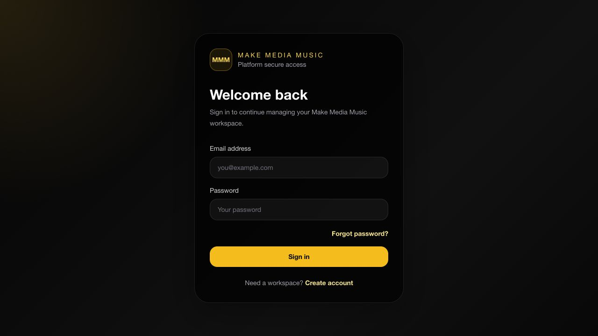
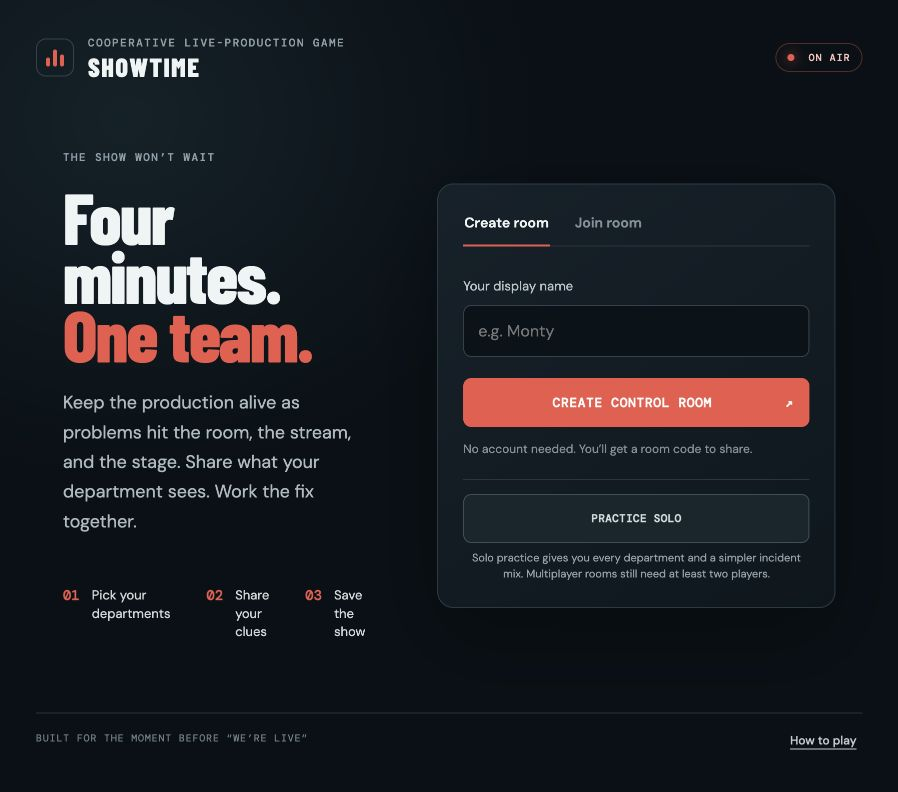

# Montrell Moore — Selected Work

**AI-assisted applications · Technical operations · Financial-services perspective · Audiovisual systems**

A curated portfolio of independent application projects, with actual application screenshots and explicit verification limits.

[View the portfolio](https://montrell-moore-portfolio.montrell-moore.chatgpt.site) · [GitHub profile](https://github.com/mmmooreproductions-bot)

## Make Media Music Platform

An actively developed MVP for music education, creative services, relationship management, studio partnerships, catalog administration, and sync licensing. Former working name: BE Music OS.

**Technology:** Next.js, React, TypeScript, Supabase, PostgreSQL, Vercel.

The private repository documents workspace permissions, tenant isolation, contact imports, projects, tasks, and collaboration. The deployed secure entry page was checked; authenticated modules were not retested for this portfolio. The application source and operational data are not included here.

## SHOWTIME: Live Production Crisis

A cooperative live-production troubleshooting game designed for 2–8 players. The public interface introduces department selection, clue sharing, and a four-minute production challenge.

[View the public interface](https://showtime-live-production-crisis.montrell-moore.chatgpt.site/)

**Status checked November 1, 2026:** the welcome screen loads; solo practice returned a connection error and the associated Supabase backend is inactive. Do not treat this as a verified playable demo.

## SHOWFLOW

An AV production operations simulation built through Google AI Studio, using an explicitly fictional arena-event dataset. The interface connects show readiness across seven systems, department operations, Dante/video/DMX routing, incidents, and shift handoffs.

[Explore the fictional demo](https://showflow-av-produc.ai.studio/)

**Status checked November 1, 2026:** Command Center, Patch Matrix, and Handoff Revisions opened successfully. This portfolio review did not validate readiness correctness, AI advice, persistence, security claims, or real hardware integration. This is a simulation prototype, not a production-safety tool.

## About this repository

This is a presentation repository containing original portfolio HTML, project summaries, and approved non-sensitive captures of public entry screens. It contains no private application implementation, database exports, contacts, credentials, or employer materials. Screenshots show actual applications; no interface was fabricated.

Open `index.html` to browse locally, or serve this folder with a static web server. No installation or API keys are required.

Copyright © 2026 Montrell Moore. No license to private project source or underlying product IP is granted by this showcase.
