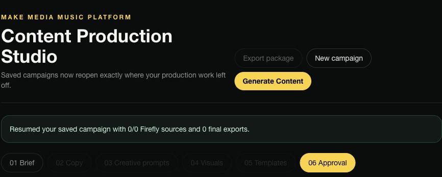
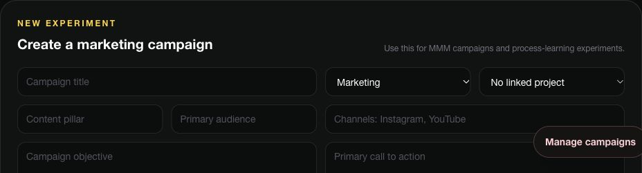
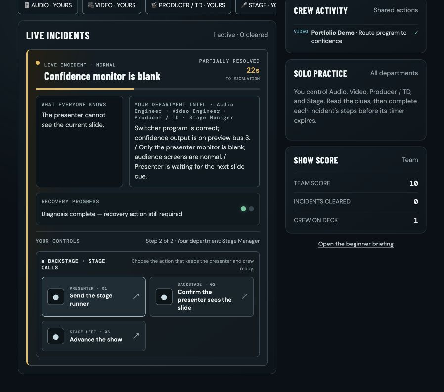
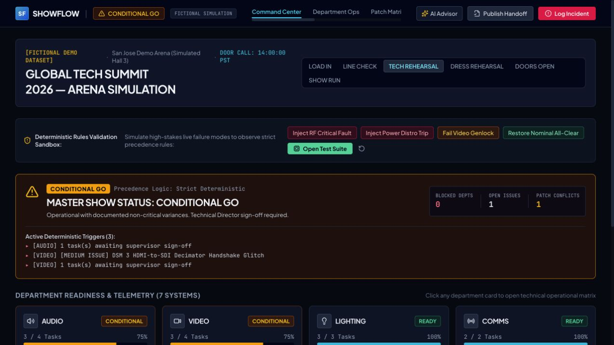
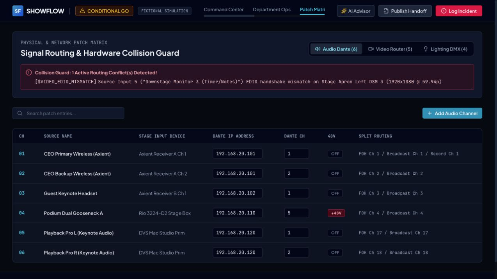

# Montrell Moore — Selected Work

**AI-assisted applications · Technical operations · Financial-services perspective · Audiovisual systems**

A curated portfolio of independent application projects, with actual application screenshots and explicit verification limits.

[View the portfolio](https://montrell-moore-portfolio.montrell-moore.chatgpt.site) · [GitHub profile](https://github.com/mmmooreproductions-bot)

## Make Media Music Platform

An actively developed MVP for music education, creative services, relationship management, studio partnerships, catalog administration, and sync licensing. Former working name: BE Music OS.

**Technology:** Next.js, React, TypeScript, Supabase, PostgreSQL, Vercel.

MMM is the flagship project: a platform joining business operations with creative production.

- **Content Studio:** staged brief, copy, prompt, visual, template, and approval interface, plus campaign-specific Firefly/Adobe Express asset handoff controls.
- **Marketing Lab:** objectives, scheduling, permissions, approvals, results capture, learning notes, and reusable playbooks.
- **Trelly Mo Universe:** a creative-production use case connecting music, visual identity, storytelling, and campaign planning. Unreleased art and story material are excluded.

Authenticated Dashboard, Content Studio, and Marketing Lab views were inspected on November 1, 2026. Generation, uploads, publishing, and measured outcomes were not tested. Story Studio returned a server error on two attempts; it is not presented as a verified working module. No production records were edited.

The private repository documents workspace permissions, tenant isolation, imports, projects, tasks, and collaboration. Its source and operational records remain private.

These are cropped screenshots of the real authenticated app, excluding private strategy, records, signed links, and unreleased artwork.

## SHOWTIME: Live Production Crisis

A cooperative live-production troubleshooting game designed for 2–8 players. The public interface introduces department selection, clue sharing, and a four-minute production challenge.

[Play SHOWTIME](https://showtime-live-production-crisis.montrell-moore.chatgpt.site/)

**Status checked November 1, 2026:** backend connectivity, solo round startup, and a two-step confidence-monitor incident recovery verified. The incident displayed CLEARED and the score increased to 20. Multiplayer and full-round completion were not retested.

## SHOWFLOW

An AV production operations simulation built through Google AI Studio, using an explicitly fictional arena-event dataset. The interface connects show readiness across seven systems, department operations, Dante/video/DMX routing, incidents, and shift handoffs.

[Explore the fictional demo](https://showflow-av-produc.ai.studio/)

**Status checked November 1, 2026:** Command Center, Patch Matrix, and Handoff Revisions opened successfully. This portfolio review did not validate readiness correctness, AI advice, persistence, security claims, or real hardware integration. This is a simulation prototype, not a production-safety tool.

## About this repository

This is a presentation repository containing original portfolio HTML, project summaries, and approved non-sensitive captures of public entry screens. It contains no private application implementation, database exports, contacts, credentials, or employer materials. Screenshots show actual applications; no interface was fabricated.

Open `index.html` to browse locally, or serve this folder with a static web server. No installation or API keys are required.

Copyright © 2026 Montrell Moore. No license to private project source or underlying product IP is granted by this showcase.
