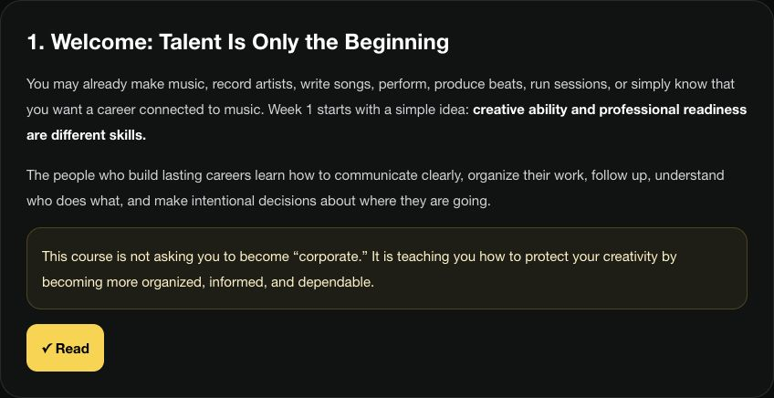
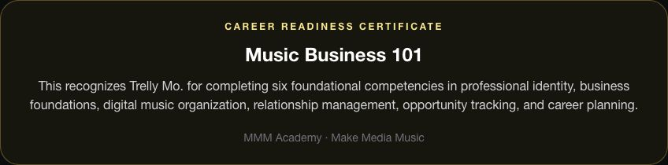

# Montrell Moore — Selected Work

**AI-assisted applications · Financial operations & risk controls · Live audiovisual production**

I am a financial-services operations professional and live-event technical lead who builds AI-assisted applications. This curated portfolio demonstrates workflow design, practical prototyping, documentation, and verification, using actual application captures and explicit testing limits.

[View the portfolio](https://montrell-moore-portfolio.montrell-moore.chatgpt.site) · [GitHub profile](https://github.com/mmmooreproductions-bot)

## Professional background informing these projects

- **Financial operations and risk controls:** wealth-management service and control workflows, recurring review, risk-based sampling, documentation of findings, risk ratings, and corrective-action recommendations. These are operational and audit-preparation responsibilities—not claims of independently conducting regulatory examinations.
- **Audiovisual production:** hands-on corporate event production including digital mixing, wireless microphone systems, signal routing, and troubleshooting as an Encore technical lead.
- **AI-assisted product work:** workflow prototyping, evaluation, and documentation, with deliberate separation between a demo's intent and tested behavior.

These are independent projects and do not imply employer endorsement.

## Make Media Music Platform

An actively developed MVP for music education, creative services, relationship management, studio partnerships, catalog administration, and sync licensing. Former working name: BE Music OS.

**Technology:** Next.js, React, TypeScript, Supabase, PostgreSQL, Vercel.

MMM is the flagship project: a platform joining business operations with creative production.

- **Content Studio:** staged brief, copy, prompt, visual, template, and approval interface, plus campaign-specific Firefly/Adobe Express asset handoff controls.
- **Marketing Lab:** objectives, scheduling, permissions, approvals, results capture, learning notes, and reusable playbooks.
- **Trelly Mo Universe:** a creative-production use case connecting music, visual identity, storytelling, and campaign planning. Unreleased art and story material are excluded.

Authenticated Dashboard, Content Studio, and Marketing Lab views were inspected on November 1, 2026. Saved output was verified in “5 Reasons Great Songs Aren’t Sync-Ready”: 7 Firefly source visuals and 7 final Adobe Express exports are present in the saved campaign. Fresh generation, uploads, public publishing, and measured business outcomes were not rerun or tested. Story Studio’s landing page returned a server error; this current access issue is separate from the verified completed content-production work. No production records were edited.

The private repository documents workspace permissions, tenant isolation, imports, projects, tasks, and collaboration. Its source and operational records remain private.

These are cropped screenshots of the real authenticated app, excluding private strategy, records, signed links, and unreleased artwork.

## MMM Academy — educational products

**Music Business 101** is a six-week course covering professional identity, business foundations, ownership and music organization, networking, opportunities, and career planning. Its Learn → Build → Reflect → Check structure combines instructional content, applied activities, reflections, and knowledge checks. Week 1 displays an 80% passing threshold. Six milestones build a Career Launch Portfolio and unlock an **MMM Academy Career Readiness Certificate**.

**Sync-Ready Creator** contains ten lessons covering licensing, rights, production, session organization, alternate versions, stems, metadata, song-package readiness, and readiness scoring. The live Education Center reports ten published lessons with its overall course still labeled draft.

Course pages, lesson content, progress, assessment controls, and the MMM-issued certificate were inspected. Fresh grading and issuance were not retested. These are education products created within MMM; no external accreditation is claimed.

Screenshots exclude private reflections, student contact records, and quiz answers. The certificate example uses the founder’s saved profile to demonstrate the feature.

## SHOWTIME: Live Production Crisis

A cooperative live-production troubleshooting game designed for 2–8 players. The public interface introduces department selection, clue sharing, and a four-minute production challenge.

[Play SHOWTIME](https://showtime-live-production-crisis.montrell-moore.chatgpt.site/)

**Status checked November 1, 2026:** backend connectivity, solo round startup, and a two-step confidence-monitor incident recovery verified. The incident displayed CLEARED and the score increased to 20. Multiplayer and full-round completion were not retested.

## SHOWFLOW

An AV production operations simulation built through Google AI Studio, using an explicitly fictional arena-event dataset. The interface connects show readiness across seven systems, department operations, Dante/video/DMX routing, incidents, and shift handoffs.

[Explore the fictional demo](https://showflow-av-produc.ai.studio/)

**Status checked November 1, 2026:** Command Center, Patch Matrix, and Handoff Revisions opened successfully. This portfolio review did not validate readiness correctness, AI advice, persistence, security claims, or real hardware integration. This is a simulation prototype, not a production-safety tool.

## About this repository

This is a presentation repository containing original portfolio HTML, project summaries, and approved non-sensitive captures of public entry screens. It contains no private application implementation, database exports, contacts, credentials, or employer materials. Screenshots show actual applications; no interface was fabricated.

Open `index.html` to browse locally, or serve this folder with a static web server. No installation or API keys are required.

Copyright © 2026 Montrell Moore. No license to private project source or underlying product IP is granted by this showcase.
